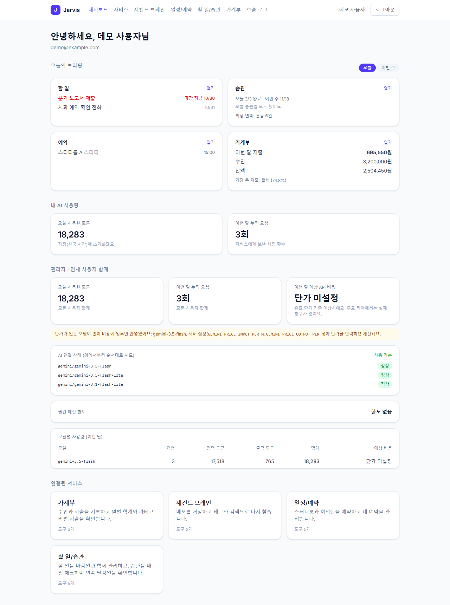
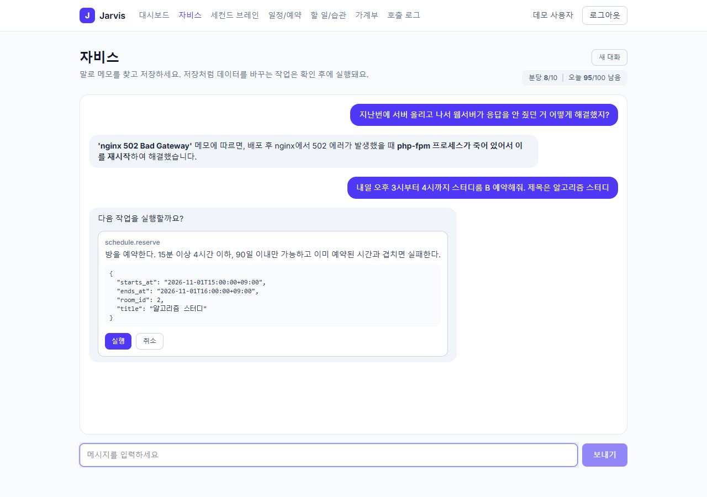
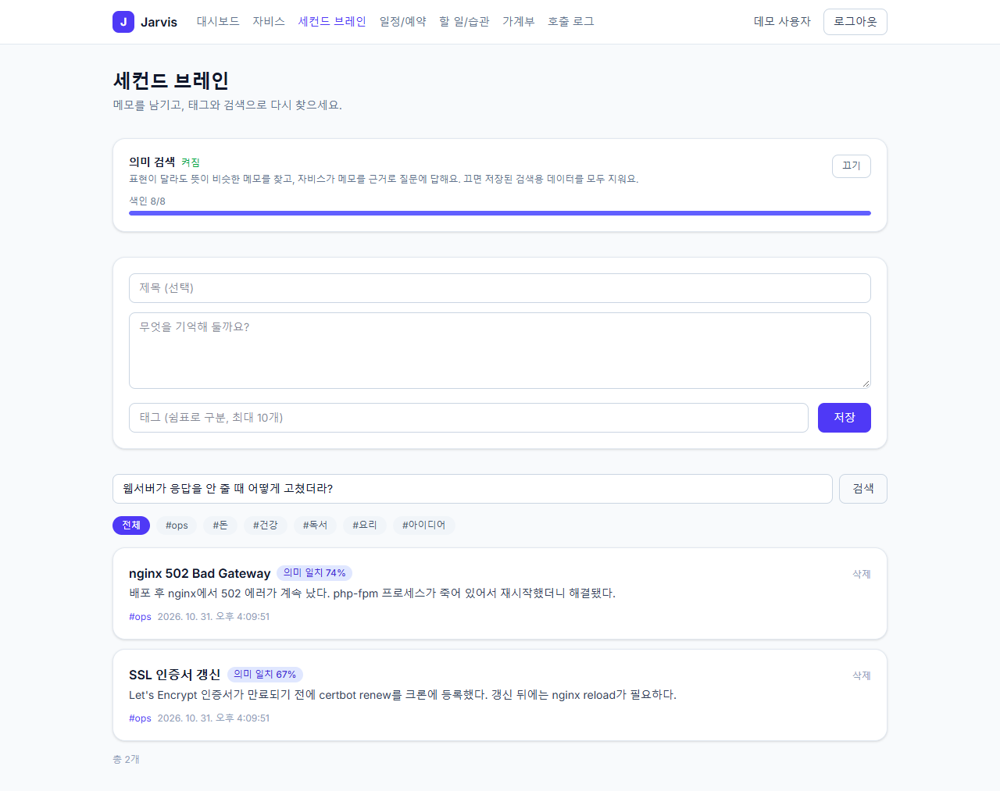
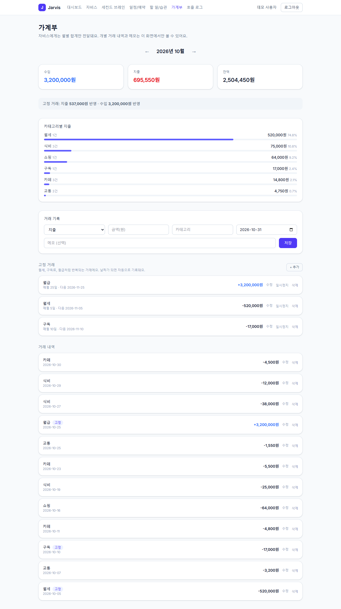
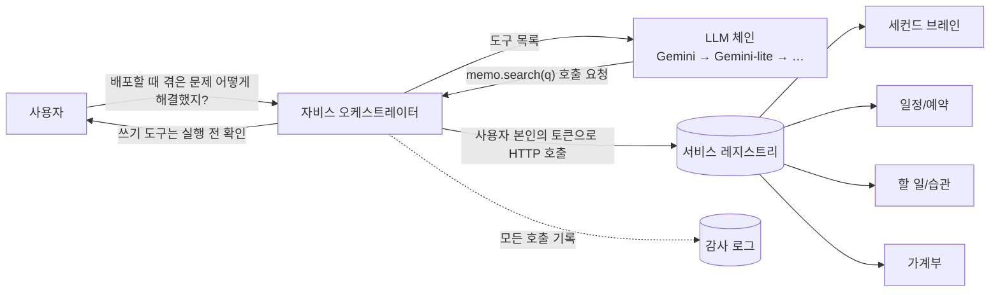

# Jarvis — 서비스 레지스트리 기반 AI 허브

여러 개인 서비스(메모, 일정/예약, 할 일/습관, 가계부)를 하나의 **AI 비서(자비스)** 가 자연어로 다루는 프로젝트입니다.
핵심 아이디어는 **서비스가 자기 기능을 "도구"로 레지스트리에 등록하면, 허브 코드를 거의 건드리지 않고도 자비스가 그 기능을 쓸 수 있다**는 것입니다.

PHP(Laravel)가 주력인 백엔드, React Router 프런트, 무료 티어로 운영하는 AI 연동까지 **기획부터 운영 구성까지 혼자 설계하고 구현**했고(AI 코딩 도구를 사용했습니다), 만든 것보다 **실제로 돌려서 검증하고 고친 과정**을 문서로 남기는 데 힘을 썼습니다.

| | |
|---|---|
| 백엔드 | PHP 8.4, Laravel 13, PostgreSQL 16 + pgvector, Nginx + PHP-FPM, Docker |
| 프런트 | React 19, React Router 8(SPA 모드), Tailwind CSS 4, TypeScript |
| AI | Gemini(무료 티어, 모델 체인) · Groq/OpenRouter/Ollama(OpenAI 호환) · 임베딩 기반 의미 검색(RAG) |
| 품질 | 테스트 212개(PostgreSQL), GitHub Actions CI, Pint, 변이 검사 |

<p>
  
  
</p>
<p>
  
  
</p>

> 스크린샷은 모두 지어낸 더미 데이터입니다. 더 많은 화면은 [docs/screenshots/](docs/screenshots/)에 있습니다.

## 어떻게 동작하나



1. 각 서비스는 자기 기능을 **도구 스펙**(이름, 설명, JSON Schema, 엔드포인트, 읽기/쓰기)으로 `service_tools` 테이블에 등록합니다. 시더 한 번이면 끝이고, 허브 코드는 바뀌지 않습니다.
2. 자비스는 등록된 도구 목록을 LLM에 주고, LLM이 고른 도구를 **사용자 본인의 토큰으로** 호출합니다. 자비스가 사용자보다 많은 권한을 갖지 않습니다.
3. **읽기 도구는 바로 실행하고, 쓰기 도구는 `pending`으로 멈춰** 사용자가 확인 버튼을 눌러야 실행됩니다(10분 만료, 한 번만 실행).
4. 모든 도구 호출은 감사 로그에 남고, 호출 로그 화면에서 볼 수 있습니다.

## 서비스

| 서비스 | 하는 일 | 자비스 도구 |
|---|---|---|
| **세컨드 브레인** | 메모, 태그, **키워드+의미 하이브리드 검색**, 메모를 근거로 한 질문 답변 | `memo.search` `memo.create` |
| **일정/예약** | 공용 방 예약. **이중 예약을 DB 수준에서 차단** | `schedule.list_rooms` `check_availability` `my_reservations` `reserve` `cancel` |
| **할 일/습관** | 마감일 할 일, 습관 체크, 연속 달성일 | `tasks.list_todos` `add_todo` `complete_todo` `list_habits` `check_habit` |
| **가계부** | 수입/지출, 월별 집계, **매월/매주/매년 고정 거래 자동 기록** | `ledger.summary` `add_entry` `add_recurring` |
| **허브** | 통합 인증(Sanctum), 레지스트리, 호출 로그, 사용량/한도 대시보드, 오늘의 브리핑 | — |

## 이 프로젝트에서 신경 쓴 것

기능 목록보다 **"어떤 문제를 만났고 어떻게 확인했는지"** 가 더 중요하다고 생각해서, 측정한 값과 함께 적었습니다. 자세한 내용은 [docs/DECISIONS.md](docs/DECISIONS.md)에 있습니다.

- **이중 예약 방지** — 트랜잭션 + 행 잠금 + PostgreSQL 배타 제약(`EXCLUDE USING gist`)의 2중 방어. 서로 다른 사용자 8명이 같은 슬롯을 동시에 예약하면 **2회 모두 1건 성공, 7건 충돌**, DB에는 1행.
- **동시 요청에서 서비스 전체가 멈추던 문제를 찾아 고침** — 자비스 도구 호출이 같은 서버를 다시 부르는 구조라 PHP-FPM 워커(5개)가 서로를 기다리며, 브리핑 **6건 동시 요청이 전부 60초 타임아웃**. 내부 호출 전용 풀로 분리한 뒤 12건 동시 요청이 전부 200(가장 느린 것 0.5초). → [ADR-5](docs/DECISIONS.md#adr-5-내부-호출-전용-php-fpm-풀)
- **RAG를 "붙였다"가 아니라 "측정했다"** — 더미 메모 23개/질문 29개로 평가 도구(`php artisan memos:eval`)를 만들었습니다. 표현이 다른 질문에서 recall@3이 **키워드 0% → 하이브리드 85%**, 무관한 질문의 오탐은 평균 0.08개. 처음 정한 임계값은 표본이 작아서 틀렸고, 표본을 늘려 바로잡았습니다. → [docs/RAG_EVAL.md](docs/RAG_EVAL.md)
- **무료 티어에서 살아남기** — Gemini 무료 한도가 **프로젝트·모델당 하루 20회**라는 것을 실제 429 응답으로 확인하고, 모델 체인 + 한도 차단기 + 키워드 검색 대체로 대응. 실제 일일 한도 소진 → 차단 → 다음 모델 전환을 라이브로 확인했습니다.
- **개인정보 설계** — 가계부 도구는 합계만 돌려주고 거래 내역·메모는 LLM에 보내지 않습니다. 의미 검색은 **사용자가 직접 켠 경우에만** 메모가 임베딩 제공자로 전송되고, 끄면 벡터를 모두 지웁니다(테스트로 보장).
- **테스트를 믿을 수 있게** — 모든 핵심 보호 장치를 **일부러 꺼서 테스트가 실패하는지** 확인했습니다(변이 검사). 그 과정에서 아무것도 검증하지 못하던 테스트를 여러 개 찾아 고쳤습니다. → [docs/TESTING.md](docs/TESTING.md)
- **실제 환경에서 검증** — 운영 구성을 로컬에서 실제로 띄워(TLS, 요청 제한, 백업→복원, 배포 스크립트) 확인했고, 깨끗한 클론에서 CI 단계를 재현했으며, 실제 브라우저로 화면을 돌려 봤습니다. 그 과정에서 **로컬에서는 안 보이던 버그 4개**(Accept 헤더 없는 요청의 500, Docker에서의 프런트 빌드 실패, 헬스체크 오류, 마크다운 별표 노출)를 찾았습니다.

## 빠른 시작 (로컬)

필요한 것: Docker, Node 22 이상. PHP와 Composer는 설치하지 않아도 됩니다(컨테이너에서 실행).

```bash
# 1) 백엔드 (nginx + php-fpm + postgres/pgvector)
cp backend/.env.example backend/.env         # GEMINI_API_KEY는 비워도 동작합니다(키워드 검색/규칙 기반 모드)
docker compose up -d --build
docker compose exec app composer install
docker compose exec app php artisan key:generate
docker compose exec app php artisan migrate --seed

# 2) 프런트
cd frontend && npm ci && npm run dev         # http://localhost:5173  (API는 Vite 프록시가 localhost:8080으로 넘김)
```

- AI 대화를 쓰려면 [Google AI Studio](https://aistudio.google.com)에서 무료 키를 받아 `backend/.env`의 `GEMINI_API_KEY`에 넣고 `docker compose exec app php artisan config:clear`를 실행합니다. 키는 서버에만 두고 저장소에 올리지 않습니다.
- 관리자 대시보드를 보려면 가입 후 `docker compose exec app php artisan user:admin 내이메일`을 실행합니다.
- Windows PowerShell에서 `npm`이 스크립트 실행 정책으로 막히면 `npm.cmd run dev`를 쓰거나 Git Bash/cmd를 사용하세요.

## 테스트

```bash
docker compose exec app php artisan test        # SQLite(메모리): 빠름. PostgreSQL 전용 테스트는 건너뜀
# PostgreSQL(pgvector)에서 전체 실행: 배타 제약, CHECK 제약, 벡터 거리 계산까지 검증
docker compose exec -e DB_CONNECTION=pgsql -e DB_HOST=db -e DB_PORT=5432 \
  -e DB_DATABASE=jarvis_test -e DB_USERNAME=jarvis -e DB_PASSWORD=secret app php artisan test
docker compose exec app ./vendor/bin/pint --test   # 코드 스타일
cd frontend && npm run typecheck && npm run build
```

현재 **PostgreSQL 212개 통과 / SQLite 208개 통과(PostgreSQL 전용 4개 건너뜀)**. CI(`.github/workflows/ci.yml`)가 스타일, SQLite, PostgreSQL(pgvector 서비스 컨테이너), 프런트 빌드, 운영 이미지와 nginx 설정 검증을 돌립니다.

## 문서

| 문서 | 내용 |
|---|---|
| [docs/ARCHITECTURE.md](docs/ARCHITECTURE.md) | 구성도, 대화 흐름, LLM 체인, RAG, 데이터 모델 |
| [docs/DECISIONS.md](docs/DECISIONS.md) | 설계 결정 14개와 그 근거, 실측으로 발견한 문제들 |
| [docs/RAG_EVAL.md](docs/RAG_EVAL.md) | 검색 품질 평가 방법과 결과 |
| [docs/TESTING.md](docs/TESTING.md) | 테스트 전략, 변이 검사, 알려진 함정 |
| [docs/OPERATIONS.md](docs/OPERATIONS.md) | 배포, 백업/복원, 운영 점검, 문제 해결 |

## 검증 상태와 한계

솔직하게 정리합니다. **직접 실행해서 확인한 것**과 **확인하지 못한 것**을 구분했습니다.

**확인한 것**
- 모든 기능의 자동 테스트(PostgreSQL 212개), 실제 Gemini 호출(도구 호출, 쓰기 확인, 한도 소진 시 모델 전환, 임베딩, RAG 답변)
- 운영 구성을 로컬에서 실제로 기동: TLS, HTTP→HTTPS, 보안 헤더, 인증 경로 요청 제한(nginx와 Laravel 각각), 내부 포트 비공개, 12건 동시 요청, 백업→복원(행 수와 `vector` 타입 일치), 배포 스크립트 전 과정
- 깨끗한 클론에서 CI 단계 재현(스타일, SQLite, PostgreSQL, 프런트 빌드, 운영 이미지 빌드), 워크플로 문법 검사(actionlint)
- 실제 브라우저(Chrome)로 15개 화면 흐름과 모바일 폭

**확인하지 못한 것**
- **실제 AWS 서버와 Vercel에 배포한 적은 없습니다.** 도메인과 서버가 없어서 Let's Encrypt 인증서 발급, GHCR 이미지 pull, 배포 워크플로(`deploy.yml`) 실제 실행은 미검증입니다. 설정과 절차는 로컬 검증을 거쳐 작성했습니다.
- Groq, OpenRouter, Ollama 클라이언트는 키가 없어 **단위 테스트(HTTP 가짜 응답)만** 거쳤습니다.
- GitHub Actions를 실제 러너에서 돌려 보지는 않았습니다(로컬 재현과 린트까지).
- 평가용 메모는 23개뿐이고 모두 더미입니다. 실제 사용 데이터에서는 임계값을 다시 재야 합니다.

## 라이선스

포트폴리오 목적의 개인 프로젝트입니다.
