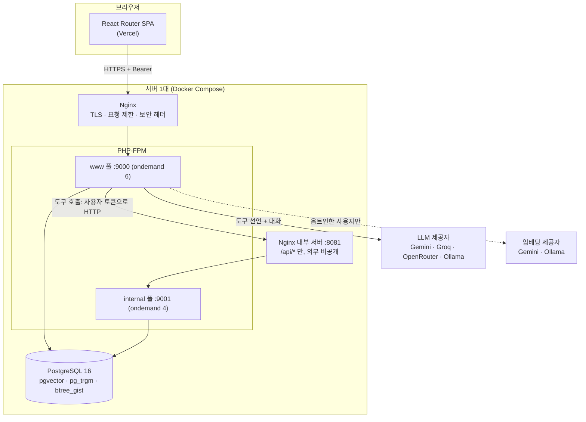
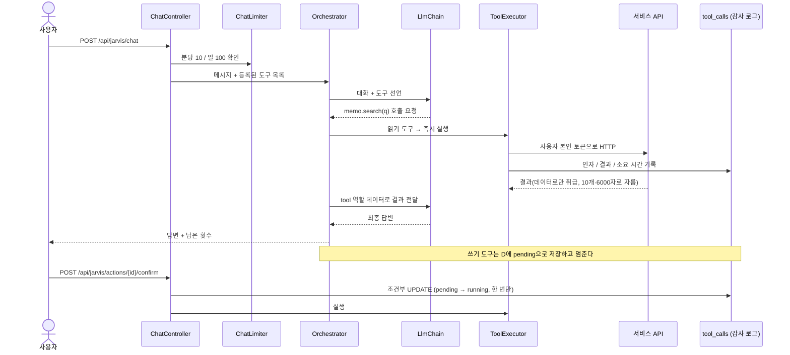
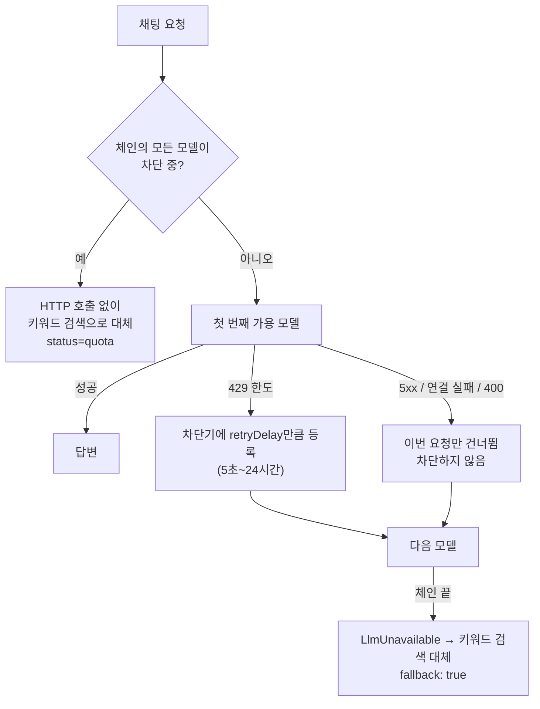
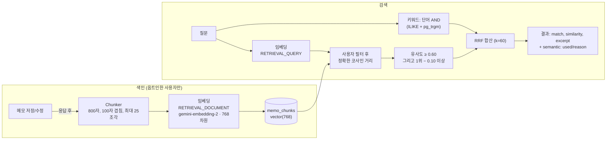
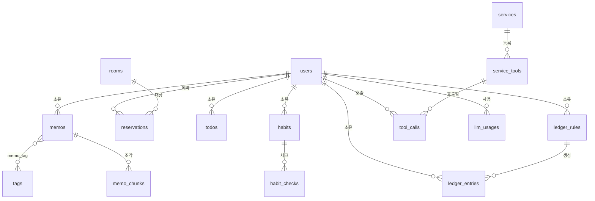

# 아키텍처

## 1. 전체 구성



- 프런트와 API는 도메인이 다르다(Vercel vs 서버). 브라우저 요청은 CORS 허용 목록(`CORS_ALLOWED_ORIGINS`)으로만 통과한다.
- 자비스가 도구를 부를 때는 **바깥 요청을 처리 중인 워커와 다른 풀**을 쓴다(교착 방지, [ADR-5](DECISIONS.md#adr-5-내부-호출-전용-php-fpm-풀)).

## 2. 채팅 한 번의 흐름



## 3. LLM 체인과 한도 대응



- 제공자: `gemini`, `groq`, `openrouter`, `ollama`. 뒤의 셋은 OpenAI 호환 클라이언트를 공유하며, 도구 이름의 `.`을 `__`로 바꿔 보내고 되돌린다.
- 키가 없는 제공자는 건너뛴다. 쓸 수 있는 항목이 없으면 규칙 기반 클라이언트가 처리한다("저장: 내용" 또는 검색어).
- 사용량은 채팅 1건당 `llm_usages` 1행이다(모델이 바뀌어도). 비용은 저장하지 않고 조회 시 설정된 단가로 계산한다.

## 4. 메모 검색 (RAG)



- 의미 검색을 못 쓰면(`disabled | indexing | unavailable | quota`) 키워드만으로 찾고 이유를 알려 준다.
- SQLite(테스트)에서는 벡터를 JSON 텍스트로 저장하고 PHP로 유사도를 계산한다. PostgreSQL 테스트가 SQL 결과와 PHP 결과의 **순서가 같은지** 직접 비교한다.
- 모델을 바꾸면 현재 모델의 벡터만 검색하고 옛 벡터는 재색인 때 지운다. 차원 768은 컬럼에 고정되어 있어 바꾸려면 마이그레이션과 재색인이 필요하다.

## 5. 데이터 모델



핵심 제약:

| 테이블 | 제약 | 목적 |
|---|---|---|
| `reservations` | `EXCLUDE USING gist` (방 + 시간 범위, 확정만) | 이중 예약 차단 |
| `ledger_entries` | CHECK(amount>0), `unique(rule_id, occurred_on)` | 금액 검증, 고정 거래 중복 방지 |
| `habit_checks` | `unique(habit_id, date)` | 하루 1회 |
| `memo_chunks` | `vector(768)` | 임베딩 저장 |
| `tool_calls` | 상태 컬럼 + 조건부 UPDATE | 쓰기 도구를 한 번만 실행 |

## 6. 코드 구조

```
backend/app/
  Jarvis/     오케스트레이터, LLM 체인/차단기/클라이언트, ToolExecutor, 사용량, 브리핑
  Rag/        임베더, Chunker, VectorStore, MemoIndexer, MemoSearch
  Schedule/   ReservationBooker (예약 트랜잭션)
  Tasks/      HabitStats (연속 달성일 계산, 순수 함수)
  Ledger/     RecurrenceSchedule, RecurringApplier
  Http/Controllers/  서비스별 컨트롤러
  Console/Commands/  memos:eval, memos:index, user:admin
backend/database/seeders/  서비스별 도구 등록 시더 (멱등)
frontend/app/routes/       화면 (대시보드, 메모, 자비스, 일정, 할 일, 가계부, 로그)
docker/    개발/운영 Dockerfile, nginx, php-fpm 풀 설정
scripts/   backup, restore, smoke, deploy
```

새 서비스를 붙이는 방법: API를 만들고, 시더에서 `services`와 `service_tools`에 도구를 등록한다. 허브 코드는 건드리지 않는다.
